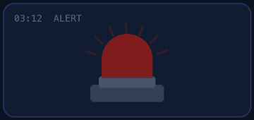
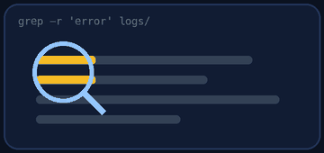
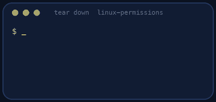

<p align="center"></p>

| | |
|-|-|
| **Time** | 60-75 min |
| **Cost** | free |
| **You need** | Your Ubuntu environment (WSL or OrbStack machine) with sudo |

## How this lab works

1. **Fork** this repository to your own GitHub account (button at the top right).
2. Clone **your fork** in your Ubuntu environment (WSL on Windows, your OrbStack machine on Mac).
3. Read the lab below (the same text is in [`LAB.md`](LAB.md)) and follow the mission.
4. Answer the questions in [`SUBMISSION.md`](SUBMISSION.md). Where a question asks for output, paste it in a code block. No screenshots needed.
5. Commit and push. Open the **Actions** tab of your fork (click *I understand my workflows, go ahead and enable them* the first time). The **Lab check** shows what is still missing.
6. When the check is green, **submit the URL of your fork** in the course platform.

> [!NOTE]
> The check only looks at your answers and any files the lab asks you to commit. Your instructor reads your work and may ask you to explain any line.

<p align="center"></p>

## 🎬 The situation

<p align="center"></p>

It is Friday, 17:40. The nightly security scan of Clipstr's **staging server** came back with one line in red:

> `HIGH: unprivileged user 'intern' can read database credentials on clipstr-staging`

At the same time, the 17:52 deploy failed with `Permission denied` and the developer on call is one tired click away from typing `chmod -R 777`. You are the DevOps engineer on duty. The investors' security consultant reads the scan on Monday.

> [!IMPORTANT]
> **Your mission**
> - Investigate the server like an auditor: find **every** permission problem, without changing anything yet
> - Fix them with least privilege, as a **script** you can run again (`fix.sh`)
> - Prove the fix works with the verifier and by trying to break in as `intern`
> - See, with your own eyes, why `chmod -R 777` is never the answer

**Time:** 60-75 min | **Cost:** free | **You need:** your Ubuntu environment (WSL, or your OrbStack machine on Mac) and `sudo`

> This lab creates three users and a folder at `/srv/clipstr` on your Ubuntu environment. `sudo ./teardown.sh` removes them whenever you want. Do not run it on a shared or production machine.

<p align="center"></p>

## Part 1: Recon (look, do not touch)

<p align="center"></p>

Build the crime scene:

```bash
sudo ./setup.sh
```

You now have a staging server at `/srv/clipstr` with three users: `clipstr` (the app's service account), `deploy` (a developer, member of the group `devs`) and `intern` (not in `devs`).

> [!NOTE]
> **Predict** Before running any command, write down your guesses (you will answer about them in your submission):
> 1. Can `intern` read `/srv/clipstr/config/app.env`?
> 2. Can `deploy` run `/srv/clipstr/scripts/deploy.sh`?
> 3. Which files in the tree can **anyone** on the machine modify?

Now check your guesses. Read-only tools to use (look up what each does with `man` or `--help`):

| Tool | Use it to |
|------|-----------|
| `ls -laR /srv/clipstr` | see owner, group and mode of everything |
| `stat <file>` | see the exact mode in octal and the owner |
| `find /srv/clipstr -perm -o+w` | find things **others** can write to |
| `find /srv/clipstr -perm /6000` | find setuid and setgid files |
| `sudo -u intern cat <file>` | try as another user, for real |
| `namei -l <path>` | walk a path and show the permissions of **every** directory on the way |

Keep notes as you go (copy the interesting output, you will need it for your answers).

### Mystery: why did the deploy fail?

Open `/srv/clipstr/deploy-error.log`. The error says `main.py: Permission denied`. Yet `ls -l` shows that file as readable by everyone. Run:

```bash
sudo -u deploy cat /srv/clipstr/app/releases/v1/main.py
namei -l /srv/clipstr/app/releases/v1/main.py
```

Look closely at the output of `namei`. Which directory is the culprit, and what exactly is missing? (Remember what the `x` bit means on a **directory**.)

> [!NOTE]
> **Think** Make a table of at least **six** distinct problems: path, what is wrong, what could go wrong because of it. You will need it for the submission.

<p align="center"></p>

## Part 2: Build the fix

Target end state. You decide the exact commands (`chown`, `chmod`, `chgrp`); the table says what must be true:

| Path | Owner : group | What must hold |
|------|---------------|----------------|
| `/srv/clipstr` and its top-level files | `root:root` / `root:devs` | Nobody but root can modify |
| `config/` and `config/app.env` | `root:clipstr` | The app reads it. Nobody else can read it. Nobody but root writes it |
| `app/` (code) | `root` | Anyone can walk the directories. The app can **read** `main.py` but **not modify** it |
| `logs/` | `clipstr:devs` | The app writes, developers read, and **new files inherit the group `devs`** |
| `scripts/` and `deploy.sh` | `root:devs` | Developers can execute it. Only root can change it |
| `keys/` and `keys/deploy_key` | `deploy:deploy` | Only `deploy` can even see the key |
| `data/` | `clipstr:clipstr` | Only the app can use it |
| `backups/dump` | `root:root` | No setuid bit |

Write your commands into a file called **`fix.sh`** in this repository (start with `#!/usr/bin/env bash` and `set -euo pipefail`). Run it with `sudo ./fix.sh`.

> [!NOTE]
> **Think** (while you work on `logs/`)
> - What does the **SGID bit** on a directory do (`chmod g+s` or the leading `2` in `2775`)?
> - Test it: create a file in `logs/` as `clipstr` **before** you set SGID, then **after**, and compare the group with `ls -l`. Use `sudo -u clipstr touch /srv/clipstr/logs/test1`.

> [!TIP]
> **Stuck?** `ls -l` shows owner and group, `stat -c '%U:%G %a' <path>` prints it in one line. A mode like `2775` has four digits: the first one holds setuid (4), setgid (2) and sticky (1).

<p align="center"></p>

## Part 3: Prove it

<p align="center"></p>

Two kinds of proof: an automatic one and your own attack.

```bash
sudo ./verify.sh
```

It runs 18 checks. Keep going until you see **`ALL CHECKS PASSED`**. Read each failing line: it tells you what the check wanted.

Now attack your own fix as the intern:

```bash
sudo -u intern cat /srv/clipstr/config/app.env      # what do you expect?
sudo -u intern ls /srv/clipstr/data                 # and this?
sudo -u clipstr cat /srv/clipstr/config/app.env     # the app must still work
```

Run `sudo ./fix.sh` **a second time**. Does anything change or break? A fix script that cannot be run twice is not a fix script.

<p align="center"></p>

## Part 4: Break it, the Friday 17:55 quick fix

The developer on call is tired. They run the "fix" that every forum thread suggests:

```bash
sudo ./panic.sh        # this runs: chmod -R 777 /srv/clipstr
sudo ./verify.sh
```

> [!NOTE]
> **Predict** How many checks do you think will fail? Which ones? Write the number down **before** you run `verify.sh`.

Look at the result. Compare it with your guess. Then answer: the deploy works again, so what exactly got worse?

Restore the safe state with **your** script:

```bash
sudo ./fix.sh
sudo ./verify.sh
```

If a check still fails after `fix.sh`, your script does not cover everything that `chmod -R 777` touched. Improve `fix.sh` until it restores a clean state from *any* starting point.

<p align="center"></p>

## Part 5: Investigate, two more detective questions

1. `find /srv/clipstr -perm -4000` found a file that is "setuid root". Search for what that means. Why is a setuid file owned by root particularly dangerous? (In the lab it is a harmless copy of `/usr/bin/true`; on a real server it might not be.)
2. `umask` decides the default permissions of **new** files. Run `umask`, then `sudo -u clipstr bash -c 'umask; touch /srv/clipstr/logs/t2; ls -l /srv/clipstr/logs/t2'`. Why does a file created by the app not get the group-write bit by default, and what are two ways to change that?

<p align="center"></p>

## Level up (optional)

- **ACLs:** the auditor needs to read `logs/` but must not join the group `devs`. Use `setfacl -m u:<user>:rx` and `getfacl` to give one user read access without changing owner, group or mode. When is an ACL the right tool and when is it a code smell?
- Make `fix.sh` print a short summary of what it changed.

<!-- teardown:start (generated by labs.py, do not edit) -->
## Tear down (mandatory)

<p align="center"></p>

Resources left behind cost money, keep doors open and pollute the next lab. Removing what you created is part of the job, so it is part of the submission: **you must prove it is gone**.

Do this **last**, after you have pasted your `verify` output into `SUBMISSION.md` (once you tear down, the lab can no longer be verified).

1. Run `sudo ./teardown.sh`. It removes the users `clipstr`, `deploy` and `intern`, the group `devs` and `/srv/clipstr`.

Then run the proof:

```bash
sudo ./verify-teardown.sh
```

It prints a list of checks and must end with **TEARDOWN VERIFIED**. If it reports leftovers, remove them and run it again. Paste the full output in your submission.
<!-- teardown:end -->

<!-- submission:start (generated by labs.py, do not edit) -->
## 📬 Submission

Answer the questions in `SUBMISSION.md` in **your fork** (paste output in code blocks where asked), push, then submit the **URL of your fork**.

**Files to commit**

- `fix.sh`: your fix as a script, committed to the repo

**Questions to answer**

1. List at least six problems you found. For each: the path, what was wrong, and the risk.
2. `deploy` got `Permission denied` even though the script's own permissions looked fine. Which tool showed you the real cause, and what was it? Paste the output that proves it.
3. Explain the SGID bit on a directory in your own words. What happened to a file created in `logs/` before and after you set it?
4. Paste the output of `sudo ./verify.sh` after running your `fix.sh`. It must end with **ALL CHECKS PASSED**.
5. Now run `sudo ./panic.sh` and then `sudo ./verify.sh` again. Paste the output, then explain why `chmod -R 777` is never the fix: name two concrete problems `verify.sh` reported.
6. **Tear down.** Paste the output of `sudo ./verify-teardown.sh`. It must end with **TEARDOWN VERIFIED**.
<!-- submission:end -->
